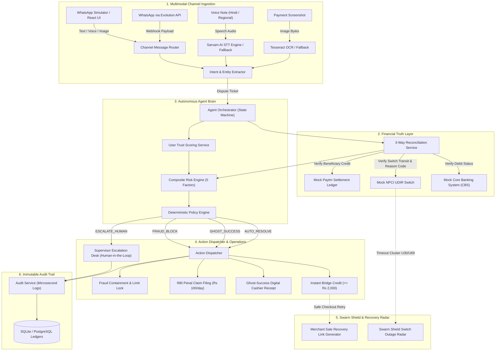
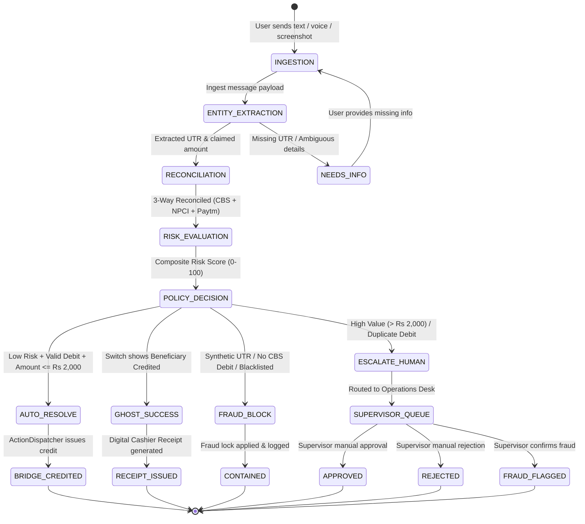
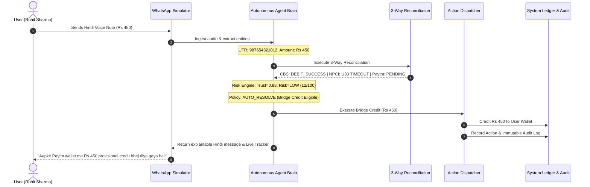

# AwaazLedger — Architecture Diagrams

This document contains Mermaid diagrams illustrating the architectural components, data flows, and state machines of AwaazLedger.

---

## 1. High-Level System Architecture

---

## 2. Autonomous Agent State Machine

---

## 3. End-to-End Sequence Flow

